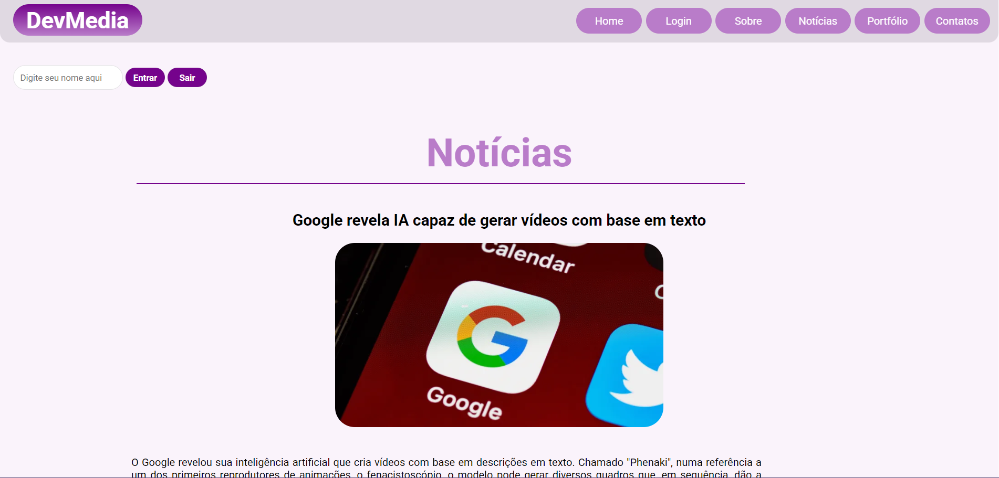
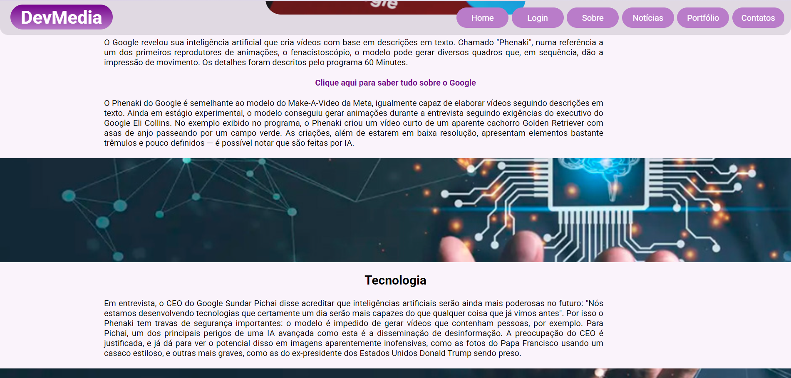
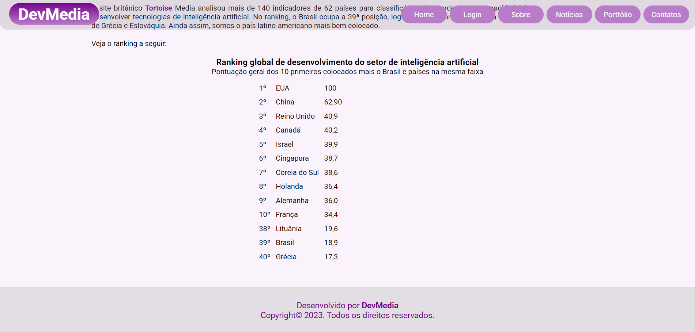
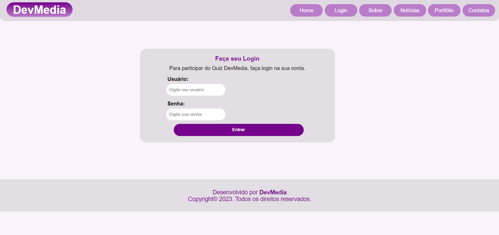
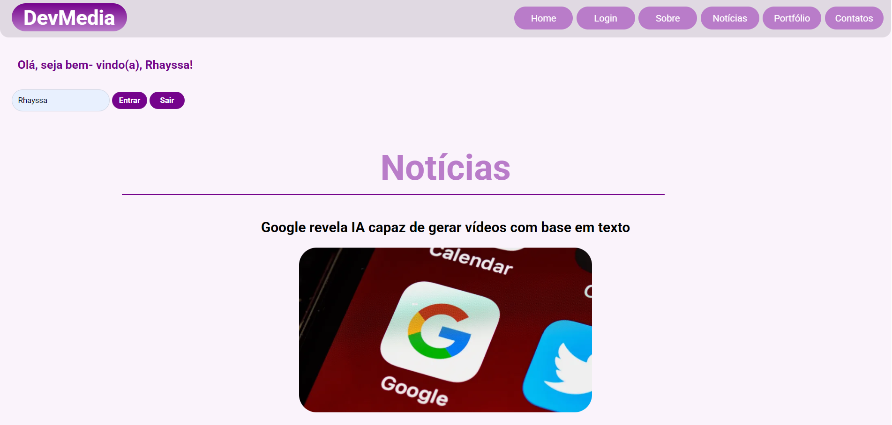

<div align="center">

  

# DevMedia - Site de Notícias

**Site interativo de notícias para praticar HTML5, CSS3 e JavaScript.**  
*Aprende fundamentos do Frontend enquanto constrói um site totalmente funcional.*

[]()
[]()
[]()

</div>

---

## 📑 Sumário

- [🎯 O que é isso](#-o-que-é-isso)
- [✨ Resultado do Projeto](#-resultado-do-projeto)
- [🛠️ Tecnologias](#️-tecnologias)
- [� Estrutura do Projeto](#-estrutura-do-projeto)
- [�🗒️ Requisitos do Projeto](#️-requisitos-do-projeto)
- [▶️ Instruções de Uso](#️-instruções-de-uso)
- [🔗 Créditos](#-créditos)
- [👩🏼‍💻 Autoria](#-autoria)

---

## 🎯 O que é isso

Esse foi meu `Primeiro Projeto no Frontend`. Foi realizado na atuação da disciplina **Código de Alta Performance Web**, com enfoque em `HTML5`, `CSS3` e `JavaScript`.

O objetivo da disciplina era apresentar e exercitar os principais fundamentos básicos para aplicação do Frontend. O projeto é de livre criatividade, bastando apenas seguir os requisitos solicitados.

  
## ✨ Resultado do Projeto







  
## 🛠️ Tecnologias

| Desenvolvimento Web | Linguagens de Programação | Frameworks e Bibliotecas | Ferramentas e Tecnologias |
| :-----------------: | :-----------------------: | :-----------------------: | :-----------------------: |
|   |  |  |  |

  
## 📁 Estrutura do Projeto

```
devmedia/
├── index.html           # Página 1 - Página Inicial
├── pagina2.html         # Página 2 - Login e Validação
├── pagina3.html         # Página 3 - Quiz
├── README.md            # Este arquivo
│
└── assets/
    ├── css/
    │   └── style.css    # Estilos do projeto
    │
    ├── js/
    │   └── script.js    # Lógica JavaScript
    │
    └── images/
        ├── logo.png     # Logo do projeto
        ├── image-1.png  # Imagem da página 1
        ├── image-2.png  # Imagem da página 2
        ├── image-3.png  # Imagem da página 3
        ├── image-4.png  # Imagem da página 4
        ├── image-5.png  # Imagem da página 5
        └── image-6.png  # Imagem da página 6
```

| Arquivo | Descrição |
|---------|-----------|
| **index.html** | Página inicial com conteúdo de notícias, lista, tabela e imagens |
| **pagina2.html** | Página de login com formulário de autenticação e validação de idade |
| **pagina3.html** | Página do quiz com 10 perguntas sobre o tema da página inicial |
| **style.css** | Arquivo de estilos CSS para todas as páginas |
| **script.js** | Lógica JavaScript para interatividade (prompts, alerts, validações) |
| **assets/images/** | Pasta contendo todas as imagens do projeto |

  
## 🗒️ Requisitos do Projeto

### 📋 Visão Geral
Crie um site de notícias em HTML/CSS/JavaScript com as seguintes funcionalidades:
- Página inicial com conteúdo de notícias
- Sistema de login com validação
- Mensagem de boas-vindas ao fazer login
- Quiz interativo com restrição de idade
- Estilização completa com CSS separado

---

### 📄 Especificações por Página
#### 📖 Página 1 - Página Inicial
**Conteúdo e Layout:**
- ✅ Mínimo de 300 palavras de conteúdo textual
- ✅ Pelo menos 2 cores de background diferentes
- ✅ Múltiplas imagens
- ✅ Uma lista (ol ou ul)
- ✅ Uma tabela
- ✅ Link externo para página de referência (com atribuição de fonte)
- ✅ Pelo menos um link externo adicional

**Interatividade (JavaScript):**
- ✅ Ao carregar a página, solicitar o nome do usuário via prompt
- ✅ Exibir mensagem de boas-vindas: "Bem-vindo(a) [NOME]!!!"
- ✅ Link de navegação para Página 2

---

#### 🔐 Página 2 - Login e Validação
**Componentes:**
- ✅ Link para retornar à Página 1
- ✅ Formulário com campos: usuário (text), senha (password) e idade (number)
- ✅ Botão "Entrar" que redireciona para Página 3

**Interatividade (JavaScript):**
- ✅ Validação com if/else para verificar maioridade (idade ≥ 18)
- ✅ Exibir alerta: "Você é maior de idade" ou "Você é menor de idade"
- ✅ Permitir acesso ao quiz apenas se maior de idade

---

#### 🎯 Página 3 - Quiz
**Formulário:**
- ✅ 10 perguntas sobre o tema da Página 1
- ✅ Pelo menos um elemento de cada tipo: text, radio, checkbox, select
- ✅ Botão "Enviar" (submit)
- ✅ Botão "Limpar" (reset)

**Estilização e Interatividade:**
- ✅ Arquivo CSS separado em `assets/css/style.css`
- ✅ Diferentes estilos para tags (ex: h1 com cores diferentes)
- ✅ Personalização de fonte, tamanho e espaçamento
- ✅ Alerta ao enviar: "Obrigado por participar do quiz!"

---

#### 🛠️ Especificações Técnicas
- ✅ **Linguagens:** HTML5, CSS3, JavaScript (sem frameworks)
- ✅ **Servidor:** HTTP-Server para execução local
- ✅ **Conteúdo de Referência:** Baseado em página Wikipedia ou similar
- ✅ **Estrutura de Arquivos:** CSS e JS em arquivos separados
- ✅ Incluir créditos/link da página de referência

  
### ▶️ Instruções de Uso

#### Pré-requisitos
- [Node.js](https://nodejs.org/en/download/package-manager) instalado
- Um navegador web moderno (Chrome, Firefox, Safari, Edge)

#### Passos para Executar

1. **Clone ou baixe o repositório**
   ```bash
   git clone https://github.com/rhayssakramer/devmedia.git
   cd devmedia
   ```

2. **Instale o http-server (se ainda não estiver instalado)**
   ```bash
   npm install -g http-server
   ```

3. **Inicie o servidor local**
   ```bash
   http-server
   ```

4. **Acesse a aplicação**
   - O servidor exibirá uma mensagem como: `Hit CTRL-C to stop the server`
   - Endereço padrão: [http://localhost:8080](http://localhost:8080)
   - Abra este URL em seu navegador

5. **Interaja com o site**
   - Informe seu nome na Página 1
   - Navegue até o login (Página 2)
   - Faça login e responda o quiz (Página 3)

#### ⚠️ Troubleshooting

| Problema | Solução |
|----------|----------|
| **Porta 8080 já está em uso** | Use `http-server -p 8081` para mudar a porta |
| **Comando http-server não encontrado** | Reinstale: `npm install -g http-server` |
| **Arquivo não carrega (404)** | Certifique-se de estar no diretório correto do projeto |
| **Estilos CSS não aparecem** | Verifique o caminho em `assets/css/style.css` |
| **JavaScript não funciona** | Verifique console (F12) para erros, confira `assets/js/script.js` |

## 🔗 Créditos
Este projeto foi desenvolvido como parte de avaliação de disciplina de **Código de Alta Performance Web**, para avaliar o ensinado em sala, sobre os fundamentos básicos aplicado do Frontend.

*Nota: Este projeto é apenas para fins educacionais e não possui nenhuma afiliação oficial com a franquia DevMedia ou suas empresas associadas.*

---

## 👩🏼‍💻 Autora

<table>
  <tr>
    <td align="left">
      <a href="https://github.com/rhayssakramer">
        <strong>Rhayssa Kramer</strong>
      </a>
      <br>
      <span>Assoc, Full-Stack Development</span>
      <br>
      <small>Avanade | Tech Content Creator | Community Speaker</small>
    </td>
  </tr>
</table>

---

<div align="center">

### ⭐ Se este projeto foi útil, considere deixar uma estrela no GitHub!

© 2026 Rhayssa Kramer. Todos os direitos reservados.

<a href="https://github.com/rhayssakramer"></a>

</div>
